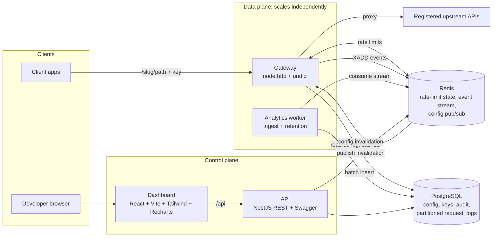

# PulseGate

PulseGate is a multi-tenant API gateway and monitoring platform. Developers register their own
upstream APIs, get a PulseGate gateway URL, and point their client applications at it. Every request
is authenticated with a PulseGate client key, checked against policies, rate limited in Redis,
proxied to the registered upstream, and recorded as metadata (never bodies) for the dashboard.

**Who it's for:** teams that want per-client API keys, rate limits, request analytics and upstream
health for an existing HTTP API without changing that API, for example a SaaS backend exposed to
partners, a mobile app backend, or an internal service shared across teams.

- [How a request flows](#how-a-request-flows)
- [Architecture](#architecture)
- [Quick start (Docker Compose)](#quick-start-docker-compose)
- [Local development without Docker for the apps](#local-development-without-docker-for-the-apps)
- [Configuration and secrets](#configuration-and-secrets)
- [Using PulseGate with your own API](#using-pulsegate-with-your-own-api)
- [curl examples](#curl-examples)
- [Rate limiting](#rate-limiting)
- [Analytics pipeline and storage](#analytics-pipeline-and-storage)
- [Security model](#security-model)
- [Operations](#operations)
- [Testing, linting and building](#testing-linting-and-building)
- [Load testing with k6](#load-testing-with-k6)
- [Production deployment](#production-deployment)
- [Known limitations and future scaling](#known-limitations-and-future-scaling)

## How a request flows

```
Client app ──► https://gateway.example.com/acme-store/v1/products?page=2
                   │  X-PulseGate-Key: pgk_…
                   ▼
PulseGate gateway ─► https://api.acme-store.com/v1/products?page=2   (registered upstream)
                   │  + configured upstream credential, minus the PulseGate key
                   ▼
Client app ◄────── upstream status, body and permitted headers (+ X-Request-Id, RateLimit-*)
```

```mermaid
sequenceDiagram
    autonumber
    participant C as Client app
    participant G as PulseGate gateway
    participant R as Redis
    participant U as Developer's upstream API
    participant W as Analytics worker
    participant P as PostgreSQL
    C->>G: GET /acme-store/v1/products (X-PulseGate-Key)
    G->>G: resolve project "acme-store" (cached config)
    G->>G: verify key hash, status, expiry; method/path policies
    G->>R: sliding-window check (key + route limits, atomic Lua)
    alt over limit
        G-->>C: 429 + Retry-After + RateLimit-*
    else allowed
        G->>U: GET /v1/products (SSRF-checked connection, timeouts)
        U-->>G: 200 + body (streamed, size-limited)
        G-->>C: 200 + body + X-Request-Id + RateLimit-*
    end
    G-)R: XADD request metadata (buffered, off the hot path)
    W->>R: XREADGROUP batch
    W->>P: INSERT … ON CONFLICT DO NOTHING, then XACK
```

## Architecture



| Path                 | Component                                                                   | Notes                                                                                                                          |
| -------------------- | --------------------------------------------------------------------------- | ------------------------------------------------------------------------------------------------------------------------------ |
| `apps/gateway`       | **Gateway** (`src/main.ts`) and **analytics worker** (`src/worker/main.ts`) | Plain `node:http` + `undici`. No framework on the hot path. Reads config through a cache; never writes PostgreSQL per request. |
| `apps/api`           | **Control-plane API**                                                       | NestJS 11, REST, Swagger at `/api/docs`. Auth, orgs, projects, upstreams, keys, policies, analytics queries, audit.            |
| `apps/web`           | **Dashboard**                                                               | React 19, Vite, Tailwind CSS 4, Recharts, TanStack Query.                                                                      |
| `apps/demo-upstream` | **Demo upstream**                                                           | Dependency-free "Acme Store" API for local demos and tests.                                                                    |
| `packages/shared`    | Shared security primitives                                                  | SSRF guard, AES-GCM secret box, API key hashing, path safety, redaction, Redis rate limiter.                                   |
| `packages/db`        | Migrations and DB ops                                                       | SQL migrations, migration runner, partition maintenance/retention, secret re-encryption.                                       |
| `loadtest/`          | k6 scenarios                                                                | Baseline, rate limit, mixed behaviour, stress.                                                                                 |

The gateway and the API share only the database schema, Redis conventions and `packages/shared`.
Each can be deployed and scaled separately; the gateway does not import any NestJS code.

## Quick start (Docker Compose)

Prerequisites: Docker with Compose v2. Nothing else is required on the host.

```bash
git clone <this repo> pulsegate && cd pulsegate
docker compose up -d --build
```

The `migrate` service applies migrations and seeds demo data, then the other services start.

| URL                                | What                                        |
| ---------------------------------- | ------------------------------------------- |
| http://localhost:5173              | Dashboard                                   |
| http://localhost:4000/api/docs     | Swagger UI (control-plane API)              |
| http://localhost:8787/demo-store/… | Gateway URL of the seeded demo project      |
| http://localhost:9464/metrics      | Gateway Prometheus metrics                  |
| http://localhost:4100              | Demo upstream (direct; for comparison only) |

Host ports can be changed with `WEB_HOST_PORT`, `API_HOST_PORT`, `GATEWAY_HOST_PORT`,
`POSTGRES_HOST_PORT` (default 55432) and `REDIS_HOST_PORT` (default 56379), e.g.
`GATEWAY_HOST_PORT=9000 docker compose up -d`.

### Demo account and keys (LOCAL DEVELOPMENT ONLY)

|                                     | Value                                               |
| ----------------------------------- | --------------------------------------------------- |
| Dashboard login                     | `demo@pulsegate.local` / `pulsegate-demo-123`       |
| Demo project                        | `demo-store` → upstream `http://demo-upstream:4100` |
| Demo client key (600 req/min)       | `pgk_00000000de_LocalDemoKeyDoNotUseInProduct01x`   |
| Rate-limit demo key (10 req / 10 s) | `pgk_000000000a_RateLimitDemoKeyLocalOnly0000000`   |
| Load-test key (high limit, k6 only) | `pgk_000000000b_LoadTestKeyLocalOnlyHighLimit000`   |

These values are public. The seed refuses to run with `NODE_ENV=production`, and the services refuse
the development pepper/encryption key and `ALLOW_PRIVATE_UPSTREAMS=true` in production. Never copy
them into a real deployment.

Try it:

```bash
curl -s http://localhost:8787/demo-store/products -H 'X-PulseGate-Key: pgk_00000000de_LocalDemoKeyDoNotUseInProduct01x'
```

Then open the dashboard, sign in, and watch the request appear under **Demo Store → Overview /
Requests** (the worker persists events within about a second).

Stop with `docker compose down` (add `-v` to delete the database and Redis volumes).

## Local development without Docker for the apps

Run PostgreSQL and Redis in Docker and the Node services on the host (Node.js ≥ 22.12, npm ≥ 10).

```bash
cp .env.example .env               # development defaults; see "Configuration and secrets"
npm ci
docker compose up -d postgres redis
npm run build:packages             # builds packages/shared and packages/db
npm run db:migrate
npm run db:seed                    # local demo data (refuses in production)

# one terminal each:
npm run dev:demo                   # demo upstream   :4100
npm run dev:api                    # control plane   :4000 (Swagger: /api/docs)
npm run dev:gateway                # gateway         :8787 (metrics :9464)
npm run dev:worker                 # analytics ingest + retention
npm run dev:web                    # dashboard       :5173 (proxies /api to :4000)
```

When running on the host the seeded upstream points at `http://localhost:4100`
(`DEMO_UPSTREAM_URL`). If you previously seeded via Compose, the upstream points at
`http://demo-upstream:4100`; edit it in the dashboard or run `docker compose down -v` first.

## Configuration and secrets

All services read environment variables (`.env.example` documents every one). Key settings:

| Variable                                                                                                                          | Used by         | Purpose                                                                                                           |
| --------------------------------------------------------------------------------------------------------------------------------- | --------------- | ----------------------------------------------------------------------------------------------------------------- |
| `DATABASE_URL`, `REDIS_URL`                                                                                                       | all             | Connection strings                                                                                                |
| `API_KEY_PEPPER`                                                                                                                  | api, gateway    | HMAC key for client-key hashes. Must be identical on API and gateway. Changing it invalidates every issued key.   |
| `ENCRYPTION_KEYS`                                                                                                                 | api, gateway    | AES-256-GCM keyring `id:base64key[,id:base64key]` for upstream credentials. First key encrypts; all keys decrypt. |
| `ALLOW_PRIVATE_UPSTREAMS`                                                                                                         | api, gateway    | **Development only.** Allows private/loopback upstreams (Docker demo). Refused when `NODE_ENV=production`.        |
| `UPSTREAM_REQUIRE_HTTPS`, `UPSTREAM_ALLOWED_PORTS`                                                                                | api             | Upstream URL policy (HTTPS required by default in production).                                                    |
| `GATEWAY_PUBLIC_URL`                                                                                                              | api             | Base URL shown to developers (e.g. `https://gateway.example.com`).                                                |
| `CORS_ORIGINS`                                                                                                                    | api             | Allowlist of dashboard origins (comma-separated).                                                                 |
| `COOKIE_SECURE`, `SESSION_TTL_HOURS`, `SESSION_IDLE_HOURS`                                                                        | api             | Session cookie policy. `COOKIE_SECURE` is forced on in production.                                                |
| `GATEWAY_MAX_REQUEST_BODY_BYTES`, `GATEWAY_MAX_RESPONSE_BODY_BYTES`, `GATEWAY_MAX_CONCURRENCY`, `GATEWAY_MAX_UPSTREAM_TIMEOUT_MS` | gateway         | Size, concurrency and timeout limits (10 MiB, 50 MiB, 2000, 120 s by default).                                    |
| `GATEWAY_CONFIG_CACHE_TTL_MS`, `GATEWAY_CONFIG_STALE_MAX_MS`                                                                      | gateway         | Config cache TTL (5 s) and stale-serving window during a PostgreSQL outage (60 s).                                |
| `RATE_LIMIT_FAILURE_MODE`                                                                                                         | gateway         | `closed` (default, 503 when Redis is down) or `open` (bypass, logged and flagged).                                |
| `ANALYTICS_*`, `RETENTION_DAYS`                                                                                                   | gateway, worker | Analytics buffering and retention (30 days).                                                                      |
| `TRUST_PROXY`                                                                                                                     | api, gateway    | Trust `X-Forwarded-*` from a fronting load balancer.                                                              |

Generate production secrets:

```bash
node scripts/generate-secrets.mjs
# API_KEY_PEPPER=…
# ENCRYPTION_KEYS=k20261016:…
```

Store them in your secret manager, never in git or in a frontend build. The dashboard bundle
contains no secrets: it talks to `/api` with an HttpOnly session cookie.

### Database migrations

```bash
npm run db:migrate         # or: docker compose run --rm migrate
```

Migrations live in `packages/db/migrations/*.sql`. The runner applies them in order, one
transaction per file, under a PostgreSQL advisory lock (safe when several containers start at once),
and refuses to continue if an already-applied file was edited. Add a new numbered file for every
schema change.

## Using PulseGate with your own API

### 1. Register an upstream

In the dashboard: **Projects → New project** (choose a slug such as `acme-store`; it becomes the
first path segment of your gateway URL and cannot be changed), then **Upstreams → Add upstream**:

| Field                 | Example                             | Meaning                                                                                      |
| --------------------- | ----------------------------------- | -------------------------------------------------------------------------------------------- |
| Base URL              | `https://api.acme-store.com`        | Where requests are forwarded. Validated against SSRF rules.                                  |
| Match prefix          | `/`                                 | Gateway path prefix routed to this upstream; with several upstreams the longest prefix wins. |
| Strip prefix          | on                                  | Remove the match prefix before forwarding (`/billing/x` → `/x`).                             |
| Allowed methods       | `GET, POST`                         | Others get `405`.                                                                            |
| Allowed path prefixes | `/v1`                               | Other paths get `403`.                                                                       |
| Timeouts              | 3000 ms connect / 15000 ms response | Exceeding them returns `504`.                                                                |
| Upstream auth         | Bearer token or custom header       | Injected on every forwarded request; encrypted at rest; never shown again.                   |

New upstreams start **disabled**. Use **Test connection** (an SSRF-safe GET through the same
connection code as the gateway) and then **Enable**. Every change is recorded in the upstream's
history with secrets redacted.

Or via the API (session cookie + CSRF token, see Swagger):

```bash
curl -s -c jar -X POST http://localhost:4000/api/auth/login -H 'content-type: application/json' \
  -d '{"email":"demo@pulsegate.local","password":"pulsegate-demo-123"}'
# -> {"user":{…},"csrfToken":"<token>"}
curl -s -b jar -X POST http://localhost:4000/api/projects/<projectId>/upstreams \
  -H 'content-type: application/json' -H 'x-csrf-token: <token>' \
  -d '{"name":"Acme API","baseUrl":"https://api.acme-store.com","auth":{"type":"bearer","secret":"<upstream token>"}}'
```

### 2. Create a client key

**API keys → Create key.** The raw key (`pgk_<10 hex>_<32 chars>`) is displayed **once**. PulseGate
stores only an HMAC-SHA256 of it; the non-secret prefix (`pgk_<10 hex>`) identifies the key in the
UI and analytics. Optionally restrict the key to methods and path prefixes, override the project's
rate limit, or set an expiry. Keys can be revoked (effective on all gateway instances immediately via
Redis pub/sub, and within the cache TTL at worst) or rotated with a grace period during which both
keys work.

### 3. Point your client at PulseGate

Replace the API base URL in the client's configuration and add the key header:

```diff
- API_BASE_URL=https://api.acme-store.com
+ API_BASE_URL=https://gateway.example.com/acme-store
+ PULSEGATE_KEY=pgk_…            # from your secret store, not committed
```

```ts
const res = await fetch(`${process.env.API_BASE_URL}/v1/products?page=2`, {
  headers: { 'X-PulseGate-Key': process.env.PULSEGATE_KEY! },
});
```

`Authorization: Bearer pgk_…` is also accepted. Any other `Authorization` value is passed through to
the upstream untouched, so an upstream can keep its own end-user auth. PulseGate keys are server-side
credentials: put them in backend services or server-rendered apps, not in public browser bundles.

## curl examples

Using the Compose demo (`K` is the local demo key):

```bash
G=http://localhost:8787/demo-store
K=pgk_00000000de_LocalDemoKeyDoNotUseInProduct01x

# Success: query string forwarded, upstream body returned, plus X-Request-Id and RateLimit-* headers
curl -i "$G/products?category=audio" -H "X-PulseGate-Key: $K"

# POST with a JSON body
curl -i -X POST "$G/orders" -H "X-PulseGate-Key: $K" -H 'content-type: application/json' \
  -d '{"productId":2,"quantity":3}'                                    # 201

# Unauthorized
curl -i "$G/products"                                                    # 401 missing_api_key
curl -i "$G/products" -H 'X-PulseGate-Key: pgk_0000000000_wrongwrongwrongwrongwrongwrong00'   # 401 invalid_api_key

# Rate limited (10 requests / 10 s key): the 11th request gets 429
R=pgk_000000000a_RateLimitDemoKeyLocalOnly0000000
for i in $(seq 1 11); do curl -s -o /dev/null -w '%{http_code} ' "$G/products" -H "X-PulseGate-Key: $R"; done; echo
curl -i "$G/products" -H "X-PulseGate-Key: $R"
# HTTP/1.1 429 Too Many Requests
# retry-after: 7
# ratelimit-limit: 10
# ratelimit-remaining: 0
# ratelimit-reset: 7
# ratelimit-policy: 10;w=10
# {"error":{"code":"rate_limited","message":"Rate limit exceeded"},"requestId":"…"}

# Upstream errors
curl -i "$G/fail?status=503" -H "X-PulseGate-Key: $K"    # upstream 503 passed through (recorded as upstream_error)
curl -i "$G/slow?delay=6000" -H "X-PulseGate-Key: $K"    # 504 upstream_timeout (demo upstream timeout is 5 s)

# Blocked by gateway policy
curl -i --path-as-is "$G/a/../../admin" -H "X-PulseGate-Key: $K"   # 400 invalid_path
```

Gateway-generated errors share one shape: `{"error":{"code","message"},"requestId"}`. Error codes:
`missing_api_key`, `invalid_api_key`, `api_key_revoked`, `api_key_expired`, `project_not_found`,
`project_disabled`, `route_not_found`, `method_not_allowed`, `path_not_allowed`,
`key_method_not_allowed`, `key_route_not_allowed`, `rate_limited`, `rate_limiter_unavailable`,
`payload_too_large`, `invalid_path`, `gateway_overloaded`, `config_unavailable`,
`upstream_timeout`, `upstream_connect_timeout`, `upstream_unreachable`, `upstream_blocked`,
`upstream_response_too_large`, `upgrade_not_supported`. Upstream responses (including 4xx/5xx) are
returned unchanged.

**Swagger UI:** http://localhost:4000/api/docs (OpenAPI JSON at `/api/docs-json`). Log in with
`POST /api/auth/login`; the browser keeps the session cookie. For mutating calls paste the returned
`csrfToken` into the **csrf** authorization (header `X-CSRF-Token`). Swagger is disabled by default
in production (`SWAGGER_ENABLED`).

## Rate limiting

**Algorithm: sliding-window counter in Redis** (`packages/shared/src/rate-limit.ts`). Each limit
keeps counts for the current and previous fixed window in one Redis hash. The rate is estimated as
`previous × (1 − elapsed/window) + current`, and a request is admitted when `estimate + 1 ≤ limit`.
This avoids the burst-at-the-boundary problem of fixed windows with O(1) memory per limit.

- **Atomic and multi-limit.** One Lua script evaluates every applicable limit and increments all of
  them only if all pass, so a request rejected by a route rule does not consume key budget. The
  script uses Redis server `TIME`, so every gateway instance shares one clock. All keys of a request
  share a `{projectId}` hash tag, so the script is Redis Cluster compatible.
- **Policies.**
  - _Project default_: per-key limit applied to every key without an override (default 600/60 s).
  - _Per-key override_: replaces the project default for that key.
  - _Route rules_: additional per-key limits for a path prefix, optionally one method
    (e.g. `POST /orders` 1200/60 s in the demo). All applicable limits must pass.
- **Headers** on every proxied response: `RateLimit-Limit`, `RateLimit-Remaining`, `RateLimit-Reset`,
  `RateLimit-Policy` (IETF draft) and the `X-RateLimit-*` equivalents. A `429` also carries
  `Retry-After` (seconds, computed from the sliding window, not just "end of window").
- **Redis unavailable.** The default `RATE_LIMIT_FAILURE_MODE=closed` returns
  `503 rate_limiter_unavailable` with `Retry-After: 1`. Limits are never silently bypassed.
  `open` is available for teams that prefer availability; bypassed responses carry
  `X-PulseGate-RateLimit: bypassed` and are logged. The gateway's Redis client fails fast
  (`enableOfflineQueue: false`, `GATEWAY_REDIS_COMMAND_TIMEOUT_MS`, default 1000 ms). The timeout is
  deliberately not tiny: under CPU saturation the gateway's own event-loop lag counts against it,
  and a too-short value turns overload into spurious fail-closed 503s.
- **Policy updates.** The API commits the change, bumps the project's `config_version` and publishes
  an invalidation on Redis pub/sub; every gateway evicts the project immediately. If a message is
  missed, the cache expires after `GATEWAY_CONFIG_CACHE_TTL_MS` (5 s), and gateways clear their
  whole cache after a pub/sub reconnect. Counters are keyed by limit window, so changing a limit
  applies to the current window immediately, and changing a window length starts a fresh window.
- **Analytics.** Rejections are recorded with outcome `rate_limited` and appear in the dashboard's
  rate-limited KPI, charts and request log.
- **Management API.** Login and registration are limited per IP (`LOGIN_RATE_LIMIT_PER_IP`) and
  login per account (`LOGIN_RATE_LIMIT_PER_EMAIL`, against credential stuffing). All management
  endpoints are limited per user (`MGMT_RATE_LIMIT_*`), and upstream connection tests have their
  own limit. These fail closed too.

## Analytics pipeline and storage

1. **Gateway → Redis Stream.** After the response is handled, the gateway appends a metadata event
   (no headers, bodies, query strings or credentials) to an in-memory buffer. A timer (250 ms)
   flushes batches with a pipelined `XADD` to `pulsegate:events` (approximate `MAXLEN` 1,000,000).
   The proxy response never waits on analytics.
2. **Worker → PostgreSQL.** `IngestWorker` reads with `XREADGROUP`, inserts a batch with one
   `INSERT … SELECT unnest(…) ON CONFLICT (created_at, id) DO NOTHING`, updates `api_keys.last_used_at`,
   commits, and only then `XACK`s. Entries left pending by a crashed worker are reclaimed with
   `XAUTOCLAIM` after 60 s. Run more workers to scale; they share the consumer group.

**Delivery and loss behaviour (no zero-loss claim):**

| Situation                              | Effect                                                                                                                                                                              |
| -------------------------------------- | ----------------------------------------------------------------------------------------------------------------------------------------------------------------------------------- |
| Normal operation                       | Events appear in PostgreSQL within roughly one flush interval plus one worker batch (about 1 s locally).                                                                            |
| Worker or PostgreSQL down              | Events accumulate in the Redis stream and are inserted when the worker recovers.                                                                                                    |
| Redelivery after a worker crash        | Duplicates are suppressed by the `(created_at, id)` primary key.                                                                                                                    |
| Gateway crashes or is killed (SIGKILL) | Up to one flush interval of buffered events is lost. Graceful shutdown (SIGTERM) flushes.                                                                                           |
| Redis unavailable                      | The gateway keeps up to `ANALYTICS_MAX_BUFFER` (50,000) events in memory and retries; beyond that the oldest are dropped and counted in `pulsegate_analytics_dropped_events_total`. |
| Worker far behind                      | The stream is trimmed at ~`ANALYTICS_STREAM_MAXLEN`; the oldest unconsumed events are lost.                                                                                         |
| Redis restarts                         | Redis runs with AOF `appendfsync everysec` in Compose: up to about 1 s of stream data can be lost.                                                                                  |

**Storage.** `request_logs` is range-partitioned **by day** on `created_at` (UTC). Indexes:
`(project_id, created_at DESC, id DESC)` for the request log and time-range aggregates,
`(org_id, created_at DESC)` for organization views, `(api_key_id, created_at)` and `(id)`. A default
partition catches rows whose day partition does not exist yet. Queries always filter by tenant and
time range, so PostgreSQL prunes partitions.

**Retention.** The worker runs maintenance hourly under an advisory lock: it creates partitions 7
days ahead, drops partitions older than `RETENTION_DAYS` (30) with `DROP TABLE` (no bulk deletes),
trims the default partition and deletes expired sessions. Run it manually with
`npm run db:retention` (or `docker compose exec worker node packages/db/dist/cli.js retention`).

## Security model

**Tenant isolation and authorization.** Every management endpoint resolves the caller's membership
through `AccessService` before touching data, and every query is scoped by `org_id`/`project_id`.
Resources in organizations you do not belong to return `404`, so their existence is not disclosed.
Roles: **owner** (everything, incl. member roles), **admin** (manage projects, upstreams, keys,
policies; add members), **member** (read-only, including analytics). The last owner cannot be
demoted or removed. Gateway keys are bound to one project; a key from another project is rejected.

**Passwords and sessions.** Passwords are hashed with Argon2id (19 MiB, t=2, p=1; tunable).
Unknown-email logins run a dummy verification to equalise timing and return the same message.
Sessions are opaque 256-bit tokens in an `HttpOnly`, `SameSite=Lax`, `Secure` (in production)
cookie scoped to `/api`. Only a SHA-256 of the token is stored; sessions have absolute (7 d) and idle
(24 h) expiry and are deleted on logout.

**CSRF.** Cookie authentication is paired with a per-session synchronizer token: mutating requests
must send `X-CSRF-Token` (constant-time comparison), and requests with a foreign `Origin` are
rejected. `SameSite=Lax` is an extra layer, not the only one.

**CORS and headers.** CORS is an explicit allowlist (`CORS_ORIGINS`) with credentials. Helmet sets
security headers on the API (CSP relaxed only for `/api/docs`); nginx sets CSP, `X-Frame-Options`,
`nosniff` and `Referrer-Policy` for the dashboard. `X-Powered-By` is disabled.

**Input validation and database access.** DTOs are validated with `class-validator`
(`whitelist` + `forbidNonWhitelisted`), path params with `ParseUUIDPipe`. All SQL is parameterised;
the only interpolated identifiers come from fixed allowlists (e.g. analytics dimensions).

**Secrets.** Upstream credentials are encrypted with AES-256-GCM using a keyring from
`ENCRYPTION_KEYS`, with the upstream id as additional authenticated data (a ciphertext copied to
another row will not decrypt). They are write-only in the API (`hasSecret: true` only), redacted
from audit history, and decrypted only inside the gateway when building the upstream request.
Client keys are stored as HMAC-SHA256 with a server-side pepper; the raw key is returned once.

**Redaction.** Gateway and API logs use pino redaction for `Authorization`, `Cookie`,
`Set-Cookie`, `X-PulseGate-Key`, `X-API-Key`, CSRF tokens and secret-like body fields; request
logging records only method and path (no query strings). Analytics store method, path (without
query), status, timings, sizes, key id and a stable error code, never bodies, headers or query
strings. Upstream errors are reduced to codes such as `upstream_unreachable`; raw error messages
(hostnames, IPs, stack traces) are not returned to clients.

**Gateway request hygiene.** The PulseGate key (`X-PulseGate-Key` or a `Bearer pgk_…`
`Authorization`) is never forwarded. Hop-by-hop headers, headers named in `Connection`,
`X-PulseGate-*`, client `X-Forwarded-*`/`Forwarded` and `Cookie` are stripped. Upstream `Set-Cookie`
is stripped from responses because all tenants share the gateway origin. The upstream host always
comes from configuration: the `Host` header and path cannot change it. Paths with dot segments
(raw or percent-encoded), encoded slashes or backslashes, NUL/control bytes or malformed escapes are
rejected (`400 invalid_path`), and the final URL is re-checked to stay under the base path.
Redirects from upstreams are returned to the client, never followed.

**SSRF defences.**

- Only `http`/`https` URLs without embedded credentials, query or fragment are accepted;
  production defaults to HTTPS-only, and ports can be allowlisted (`UPSTREAM_ALLOWED_PORTS`).
- Every address a hostname resolves to must be **globally routable unicast**. Blocked: loopback,
  RFC 1918 private, link-local (incl. `169.254.169.254`), CGNAT, unique-local IPv6, multicast,
  broadcast, unspecified, documentation/benchmark/reserved ranges, IPv4-mapped IPv6 forms of all of
  these, and NAT64/6to4/Teredo translation ranges. Known metadata hostnames are blocked by name.
  Alternative IPv4 notations (`0x7f000001`, `2130706433`) are normalised by the URL parser first.
- Validation runs when an upstream is saved **and again on every new connection**: the gateway's
  connection pool resolves DNS through a guarded `lookup` that rejects disallowed answers and hands
  only the vetted address to the socket, so the address that was checked is the one connected to.
  IP-literal hosts are re-checked per request.
- `ALLOW_PRIVATE_UPSTREAMS=true` (development only, refused in production) allows private and
  loopback ranges for Docker demos. Cloud metadata addresses stay blocked even then.

_Limits of this protection:_ it controls where PulseGate connects, not what the upstream does. An
upstream that is itself an open proxy, or that fetches attacker-chosen URLs, can still reach
internal systems from its own network. DNS answers are checked per connection, but pooled
keep-alive connections are reused until they close (`keepAliveTimeout` 10 s). Egress controls
(a network policy or firewall that denies private ranges from the gateway's network) are still
recommended in production as a second layer. Hostname blocklists cannot enumerate every provider's
internal names; the IP-range check is the primary control.

**Limits.** Request bodies (10 MiB; `413`, checked from `Content-Length` and while streaming),
response bodies (50 MiB; `502` if declared too large, connection aborted if exceeded mid-stream),
upstream connect/response timeouts (per upstream, capped by `GATEWAY_MAX_UPSTREAM_TIMEOUT_MS`),
in-flight requests (`GATEWAY_MAX_CONCURRENCY`; `503 gateway_overloaded`), header and request
timeouts on the gateway server, and a 100 KB JSON limit on the API.

Security-focused tests live in `apps/api/test/tenant-isolation.e2e.spec.ts`,
`apps/api/test/upstreams-keys.e2e.spec.ts`, `apps/api/test/auth.e2e.spec.ts`,
`apps/gateway/test/*.e2e.spec.ts` and `packages/shared/src/*.spec.ts` (SSRF, redaction, crypto,
path safety).

## Operations

| Endpoint            | Meaning                                                                                                           |
| ------------------- | ----------------------------------------------------------------------------------------------------------------- |
| `GET /api/health`   | API liveness                                                                                                      |
| `GET /api/ready`    | API readiness: PostgreSQL and Redis checks (`503` if either fails)                                                |
| `GET :8787/healthz` | Gateway liveness                                                                                                  |
| `GET :8787/readyz`  | Gateway readiness: PostgreSQL and Redis; `503` while draining on shutdown                                         |
| `GET :9464/metrics` | Gateway Prometheus metrics: requests by outcome, latency histogram, in-flight, analytics buffer/dropped/published |

- **Structured logs.** JSON (pino) with `service`, level and timestamp. The API and gateway honour
  a well-formed inbound `X-Request-Id` or generate one; it is returned to the client, forwarded to
  the upstream, logged, and stored with analytics so a dashboard entry can be traced to logs.
  Gateway per-request access logs are at `debug` unless `GATEWAY_ACCESS_LOG=true`.
- **Graceful shutdown.** On SIGTERM the gateway fails readiness, stops accepting connections,
  closes idle keep-alive sockets, waits up to `SHUTDOWN_GRACE_MS` (15 s) for in-flight requests,
  flushes analytics and closes upstream pools, Redis and PostgreSQL. The API uses Nest shutdown hooks
  to close its pools; the worker finishes its current batch.
- **Config cache resilience.** If PostgreSQL is briefly unavailable, gateways keep serving cached
  configuration for up to `GATEWAY_CONFIG_STALE_MAX_MS`; revoked keys and changed projects are never
  served stale because invalidation deletes the cache entry.

## Testing, linting and building

Integration tests use real PostgreSQL and Redis (a separate `pulsegate_test` database, created
automatically, and Redis logical DBs 1 and 2), so start the infrastructure first:

```bash
docker compose up -d postgres redis
npm ci
npm test                 # builds packages, then runs every workspace's Jest suite
npm run lint             # ESLint (TypeScript, React hooks)
npm run typecheck        # tsc --noEmit for every workspace
npm run build            # compiles all services and builds the dashboard
```

Per workspace: `npm test -w @pulsegate/shared` (unit: SSRF, crypto, key hashing, paths, redaction),
`npm test -w @pulsegate/api` (Supertest e2e: auth, CSRF, tenant isolation, RBAC, upstream SSRF
validation, secret handling, keys, rate-limit policy, analytics), `npm test -w @pulsegate/gateway`
(proxy behaviour, header hygiene, traversal, limits, timeouts, rate limiting incl. Redis failure
modes and multi-instance counters, connect-time SSRF, analytics pipeline and idempotent ingest).
Override connection strings with `TEST_DATABASE_URL` and `TEST_REDIS_URL`.

## Load testing with k6

See [`loadtest/README.md`](loadtest/README.md) for parameters, reset steps and the results
template. Against Docker Compose (no local k6 needed):

```bash
docker compose up -d --build
docker compose exec redis sh -c "redis-cli --scan --pattern 'pg:rl:*' | xargs -r redis-cli del"
docker compose --profile loadtest run --rm k6 run /scripts/gateway-baseline.js
docker compose --profile loadtest run --rm k6 run /scripts/rate-limit.js
docker compose --profile loadtest run --rm k6 run /scripts/mixed-behavior.js
docker compose --profile loadtest run --rm k6 run /scripts/stress.js
```

Thresholds in the scripts are local test targets, not production capacity claims. This repository
does not ship benchmark numbers; record your own with `loadtest/results/TEMPLATE.md`.

## Production deployment

- **Topology.** Run the gateway behind a TLS-terminating load balancer as N stateless replicas
  (scale on CPU/latency), the API as a separate service, and one or more workers. Use managed
  PostgreSQL (with PgBouncer for many gateway replicas) and Redis with persistence and failover.
  Set `TRUST_PROXY=true` only when a trusted proxy sets `X-Forwarded-*`.
- **Mandatory settings.** `NODE_ENV=production`; fresh `API_KEY_PEPPER` and `ENCRYPTION_KEYS`;
  `COOKIE_SECURE=true` (enforced); `CORS_ORIGINS` set to the dashboard origin; `GATEWAY_PUBLIC_URL`;
  `ALLOW_PRIVATE_UPSTREAMS` unset (enforced); consider `UPSTREAM_ALLOWED_PORTS=443`. Do not run the
  seed. Keep `/metrics` (port 9464) internal. Serve the dashboard and `/api` from the same origin.
- **Network.** Deny gateway egress to private ranges and metadata endpoints at the network layer as
  defence in depth for SSRF. Restrict PostgreSQL/Redis to the private network.
- **Rotating the encryption key.** Generate a new key and prepend it:
  `ENCRYPTION_KEYS=k2:<new>,k1:<old>`; deploy API and gateway; run `npm run secrets:reencrypt`
  (re-encrypts all upstream secrets with `k2`); then remove `k1` and redeploy.
- **Client key rotation.** Use **Rotate** with a grace period, deploy the new key to clients, and let
  the old key expire. Revoke immediately if a key leaks.
- **API key pepper.** Treat it like a signing key: rotating it invalidates every client key, so plan
  it as a coordinated reissue.
- **Sessions.** Deleting rows from `sessions` (or `npm run db:retention`) logs users out; there is no
  separate session-signing secret to rotate.

## Known limitations and future scaling

- **Not implemented:** WebSocket/HTTP upgrade proxying (`501 upgrade_not_supported`), HTTP/2 to
  upstreams, gRPC, response caching, retries and circuit breaking, active upstream health checks
  (health is derived from live traffic plus manual tests), custom domains per project, email
  invitations/verification and password reset (members are added by the email of an existing
  account), SSE for live dashboards (polling is isolated in `apps/web/src/lib/live.ts` so it can be
  swapped).
- **CORS for browser clients of the gateway** is passed through from the upstream (preflight
  `OPTIONS` requests are proxied like any request and require a key). PulseGate keys are intended
  for server-side clients.
- **Streaming.** Request and response bodies are streamed. When a response exceeds the size limit
  mid-stream, the connection is aborted because the status line has already been sent.
- **Analytics scale.** Percentiles are computed on raw rows per query. Beyond tens of millions of
  rows per day per tenant, add per-minute rollups with latency histograms (or move request logs to a
  columnar store such as ClickHouse or TimescaleDB continuous aggregates) and keep raw rows for the
  request log only.
- **Rate limiting** is per key (and per key per route); there is no project-wide aggregate cap or
  concurrency limit per key yet. A Redis Cluster deployment is supported by the key layout but has
  not been load-tested here.
- **Config propagation** is immediate via pub/sub with a 5 s worst-case TTL. Strict read-after-write
  for revocation across a pub/sub outage would need shorter TTLs or a version check per request.
